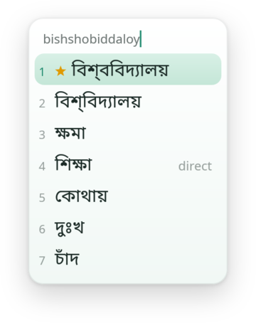
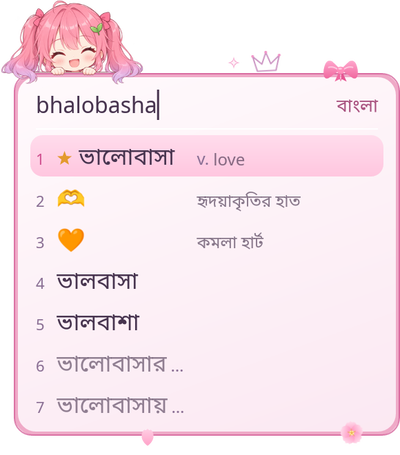
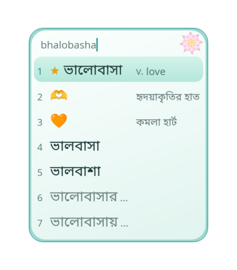
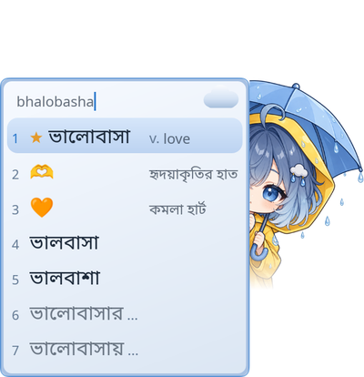
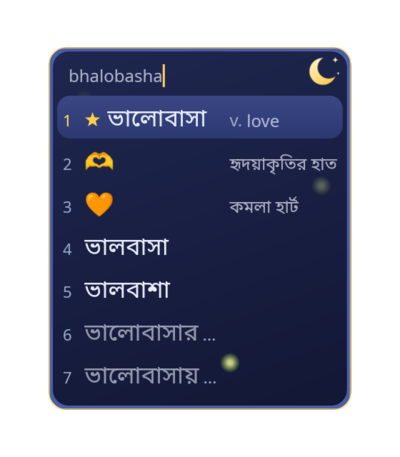

<div align="center">


# Bornopata · বর্ণপাতা

**A free Bangla input method that learns your words, and keeps them on your computer.**

Type Bangla the way you say it, in Roman letters. `ami bhalobasha` becomes `আমি ভালোবাসা`.

[Website](https://andrew-velox.github.io/Bornopata-Web/) ·
[User guide](docs/user/index.md) ·
[Install](docs/user/getting-started/install.md) ·
[Changelog](CHANGELOG.md) ·
[Roadmap](docs/plan/roadmap.md)


</div>

---

Bornopata (বর্ণপাতা, "leaf of letters") is a phonetic Bangla input method. You type the sound, it offers the words you meant, with a short English meaning beside them. It remembers what you choose and suggests what you are likely to write next. All of it works offline.

> **Status: a preview for Linux with Fcitx5.** It is tested on Arch Linux with Hyprland and Brave; other desktops are untested, so please tell us what you find. No release is published yet. Windows and macOS are planned.

## Themes

Five candidate windows, drawn for Bangladesh. Each one has its own mascot and animations, a vertical or a horizontal list, and the default has a dark variant.

<table>
  <tr>
    <td align="center"><br><b>Bornopata</b><br><sub>soft green, with a dark variant</sub></td>
    <td align="center"><br><b>Sakura</b><br><sub>cherry blossom pink</sub></td>
    <td align="center"><br><b>Shapla</b><br><sub>the water lily</sub></td>
    <td align="center"><br><b>Borsha</b><br><sub>the monsoon</sub></td>
    <td align="center"><br><b>Jonaki</b><br><sub>a night of fireflies</sub></td>
  </tr>
</table>

You can also point the config at a folder of your own theme. More in [Themes and the window](docs/user/settings/themes.md).

## Features

- **⌨️ Typing**
  - **Avro phonetic.** Type the sound: `t` is ত, `T` is ট, `ng` is ং, `^` makes ঁ. [All the letters](docs/user/input/typing-bangla.md).
  - **A 413,000-word dictionary.**
    - Real words near your spelling, the common ones first.
    - Completes from the first letters: `bangl` gives বাংলা, বাংলাদেশ.
    - Spellings of one sound meet: `bhalobasha` and `valobasha` find ভালোবাসা.
  - **Hard words too.** `moddhe` finds মধ্যে, `porjonto` পর্যন্ত, `dukkho` দুঃখ.
  - **Never stuck.** The direct conversion of your letters is always on the list.
  - **Bangla digits and marks.** `123` gives ১২৩, `.` gives `।`, `$` gives ৳.
  - **English mode.** `Ctrl+Alt+Space` hands every key back to the application, per text field.

- **🧠 It learns from you**
  - **Your choice comes first.** Pick a word once and it leads next time, even if no dictionary has it.
  - **Next-word suggestions.**
    - Up to five words after a space, taken with `Tab`.
    - Your own writing first, then a built-in word pair model (2 MB).
    - The word before also helps pick the spelling.
  - **It fades.** Words you stop using lose weight; nothing grows without limit.
  - **You decide.**
    - `Shift+Delete` forgets a wrong word or hides a suggestion.
    - One switch turns learning off, one button erases it. [What it learns](docs/user/learning/learning.md).

- **✨ Beside the words**
  - **English meanings.** A short gloss like `n. rice`, from Wiktionary. It never reorders or delays the list.
  - **Emoji.** `hridoy` offers 🫀 ❤️; English words such as `heart` work too.
  - **Date and time.** `tarikh`, `somoy` and `bar` give the date, time and weekday, with the Bengali calendar date.
  - **Your phrases.** `mymail` types your address, `sig` your signature. They come first and are never learned.

- **🪟 The candidate window**
  - **At your cursor.**
    - Wayland apps (Brave, Firefox, GTK, Qt) get it through the input-method popup.
    - X11 gets a small overlay; anything else falls back to Fcitx5's own panel.
  - **Five animated themes** with mascots, in a vertical or a horizontal list, light or dark.
  - **Correct Bengali shaping.** Conjuncts like প্র, ক্রি and স্ব are drawn properly.

- **⚙️ Settings**
  - **Bornopata Settings**, in your launcher, in English or বাংলা.
    - Typing, keys, appearance with a live preview, phrases and learning.
    - Every change applies within a second or two.
  - **One text file** for everything: `~/.config/bornopata/config.toml`. [The config file](docs/user/settings/config-file.md).

## Privacy

An input method sees everything you type, so this part is a promise, and the code is open so you can check it.

- **No network, ever.** Typing, the dictionary, learning, glosses, emoji and phrases all work offline. The Server only talks to the plugin and to your display server on your own computer.
- **Your typing is not logged.** Logs record events and errors, never the text.
- **Passwords are left alone.** In a password field Bornopata does nothing; in fields an application marks as sensitive it converts but remembers nothing.
- **What it learns is plain text** in three small files in your home directory. Open them, edit them, delete them.

See [Your files and your privacy](docs/user/help/data-and-files.md).

## Install

Bornopata has two parts: a small **Server** that does the work in the background, and a **plugin** for Fcitx5 that sends your keys to it. Both install into your home directory and need no root access.

You need Linux with Fcitx5 (version 5 or later), a Bengali font such as Noto Sans Bengali, and `systemd` user services (or start the Server yourself). Until the first release is published, build from source. You need Rust, `cmake`, a C++ compiler, `pkg-config`, `python3`, the Fcitx5 development files and `nlohmann-json`:

```bash
git clone https://github.com/Andrew-Velox/Bornopata.git
cd Bornopata
apps/linux/scripts/install.sh
systemctl --user daemon-reload
systemctl --user enable --now bornopata
fcitx5 -r
```

Then open the Fcitx5 configuration tool and add **Bornopata** to your input methods. Open any text field, switch to it and type `ami`: the window should show `আমি`, and `Space` types it.

The installer does not include the dictionary. Put `words.bnd` from the dictionary data release into `~/.local/share/bornopata/`, or only a small built-in word list will answer. Packages for each distribution, the full steps and what to do when something does not work: [Install](docs/user/getting-started/install.md) and [Troubleshooting](docs/user/help/troubleshooting.md).

## The keys

| Key | What it does |
|---|---|
| `Space` | Types the highlighted word (the first by default) and a space |
| `1`–`9` | Types that candidate |
| `↓` `Tab` / `↑` `Shift+Tab` | Moves the highlight |
| `Enter` | Types the highlighted word, then `Enter` |
| `Backspace` / `Esc` | Removes a letter / throws the word away |
| `Tab` after a space | Takes the next-word suggestion |
| `Shift+Delete` | Forgets what was learned about the highlighted word |
| `Ctrl+Alt+Space` | Switches between Bangla and English |

Both Bornopata shortcuts can be changed. The full list: [Keys and shortcuts](docs/user/getting-started/keys.md).

## Under the hood

Bornopata is written in Rust. A platform-independent Core does the dictionary, the conversion, the ranking and the learning; each platform is only a thin shell that turns key events into Core input and draws the window Core returns. Today the shell is a Server with a Fcitx5 plugin; replacing Fcitx5 with another framework needs no change in Core. Typing comes first: nothing added for a secondary feature may delay a candidate.

The design notes are in [docs/](docs/README.md); the architecture rules and how to build and test are in [docs/contributing.md](docs/contributing.md). To see the Core on its own:

```bash
cargo run -p borno-cli -- ami bangla kotha
```

## What is next

Windows and macOS shells, an Arch (AUR) package and the first public release, animated previews in the settings program, and clicking on the candidate window. The plan with the open questions is in the [roadmap](docs/plan/roadmap.md).

## Contributing

Bug reports and words that rank wrongly are the most useful thing right now: [Feedback](docs/user/help/feedback.md). Code changes follow [docs/contributing.md](docs/contributing.md). All contributions are accepted under GPL-3.0-or-later.

## Credits and licenses

- Bornopata is **GPL-3.0-or-later** ([LICENSE](LICENSE)). It started from the Qingjian pinyin input method, whose history and notice are kept ([NOTICE.md](NOTICE.md)).
- Avro conversion by [`okkhor`](https://crates.io/crates/okkhor) and a fallback word list from [`upodesh`](https://github.com/OpenBangla/upodesh), both MIT, from the [OpenBangla](https://github.com/OpenBangla) project.
- The **dictionary** is built from Bengali Wikipedia (CC BY-SA 4.0) and the Mozilla Common Voice Bengali sentences (CC0), and distributed under CC BY-SA 4.0. The **glosses** come from English Wiktionary (CC BY-SA 4.0). **Emoji** names are from the Unicode CLDR. The sources of every data set are recorded in `assets/*/README.md`.
- The logo and the theme mascots were supplied by the project owner; each theme's folder records its provenance.
- Text shaping uses a patched `cosmic-text` with `harfrust` so Bengali conjuncts form correctly ([notes](docs/notes/text-shaping.md)).
